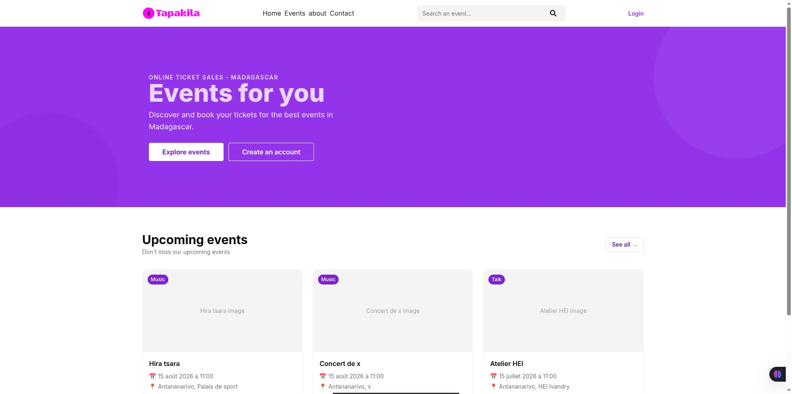

# Développeur Fullstack

**Williest ANDRY NY AINA**, Développeur Fullstack à Antananarivo, Madagascar. **Disponible immédiatement.**

**Licence informatique** à la Haute École d'Informatique (parcours Écosystème Logiciel : **développement web** et cloud). Soutenance validée, diplôme en attente de délivrance.

**Mon approche** : concevoir des architectures simples et propres, écrire du code maintenable et livrer des interfaces utilisables. Je maîtrise aussi bien la construction d'une API REST sécurisée que l'intégration côté frontend avec des outils modernes.

**[Télécharger mon CV (PDF)](https://drive.google.com/file/d/1xsc87H3w37evb_sMPgTFVEOgg4GPgiHN/view?usp=sharing)**

- E-mail : [williestnyainaandry@gmail.com](mailto:williestnyainaandry@gmail.com)
- Téléphone : [+261 32 87 774 77](tel:+261328777477)
- LinkedIn : [linkedin.com/in/williest-andry](https://www.linkedin.com/in/williest-andry)
- GitHub : [github.com/Williest-Andry](https://github.com/Williest-Andry)

 

# Expérience professionnelle

## Développeur Frontend (stage), [AllForOne](https://allforone.mg/fr) (ESN, Antananarivo)
*15 juin – 15 octobre 2026*

Projet : **Madadiaspora**, plateforme qui relie la diaspora malagasy à Madagascar pour le développement socio-économique du pays. J'ai assuré **l'intégration du nouveau front-office (site vitrine et application web à 7 rubriques)** à partir des maquettes Figma de l'équipe design et **connecté à l'API REST** de l'équipe backend.

- **Site vitrine :** globe 3D interactif (globe.gl), responsive du mobile au grand écran, chargement du globe fluidifié (préchargement de la texture, loader). **5 pages intégrées.**
- **Application web à 7 rubriques :** couche d'accès aux données centralisée (Axios, TanStack Query avec cache adapté), filtres, pagination, calendrier d'événements, interface robuste face aux données réelles (états de chargement, vide, erreur).
- **Stack :** Next.js, TypeScript, Tailwind CSS, shadcn/ui, Axios, TanStack Query, Zod, React Hook Form, GitLab.
- **Statut :** livré en test chez le client, pas encore en production.

 

# Projets

## [Tapakila](https://tapakila-ui.vercel.app/) : plateforme de réservation d'événements

[API](https://github.com/Williest-Andry/tapakila-api) · [UI](https://github.com/Williest-Andry/tapakila-ui) · [Démo live](https://tapakila-ui.vercel.app/)

<!-- Compte de démo : décommente la ligne suivante après avoir créé le compte
**Compte de démo :** e-mail `A_REMPLIR` · mot de passe `A_REMPLIR`
-->

Plateforme fullstack de billetterie (VIP, Standard, Early Bird) avec rôles et authentification JWT. Projet académique de groupe (2025) que j'ai entièrement refactorisé en solo : backend, API REST avec contrat OpenAPI, frontend et gestion d'état.

- **Stack :** Next.js 15, TypeScript, Chakra UI v3, Zustand, TanStack Query · Node.js, Express, Prisma, PostgreSQL, JWT, OpenAPI 3
- **Points clés :** types générés depuis le contrat OpenAPI (aucun type manuel sur les appels API), refresh token automatique côté client.

## [MoneyWise](https://github.com/Williest-Andry/public-money-wise.git) : application mobile de finances personnelles

[APK](https://drive.google.com/file/d/1GG8gQkYXyIyyoBsHDTXU6rX9dc7BlB4X/view?usp=drive_link) · [Vidéo de démo](https://drive.google.com/file/d/1tN60N91cRaIDys7yjPHTHvZVwI2aoBI_/view?usp=drive_link)

Projet de groupe (5 personnes, examen académique) en React Native, Expo et TypeScript. **Module Objectifs développé intégralement par moi :** CRUD, filtres par dates, notifications push à l'échéance.

## Autres projets

- **[Ligues de football](https://github.com/Williest-Andry/football-championship-api.git)** : APIs REST Spring Boot / PostgreSQL / OpenAPI 3 (statistiques des 5 grands championnats). J'ai développé seul la partie locale.
- **[Gestion de restaurant](https://github.com/Williest-Andry/sale-point-restaurant.git)** : backend Spring Boot / PostgreSQL / OpenAPI 3 en deux niveaux (API centrale et API par point de vente, dont j'ai développé la partie point de vente).

---

# Compétences

- **Frontend :** Next.js, React, React Native, React Admin, TypeScript, TanStack Query, Axios, React Hook Form, Zod, Zustand, Tailwind CSS, shadcn/ui, Chakra UI
- **Backend :** Node.js / Express, Spring Boot, JWT, Prisma, PostgreSQL
- **Outils :** Git, GitHub, GitLab, GitHub Actions, OpenAPI 3, Postman, Docker, Jira, Trello

# Formation et langues

**Licence informatique**, Haute École d'Informatique, Antananarivo (octobre 2023 – novembre 2026) · POO, API REST, interface web, sécurité informatique.

Français B2 (TV5MONDE) · Anglais : lecture de documentation technique · Malagasy : langue maternelle
